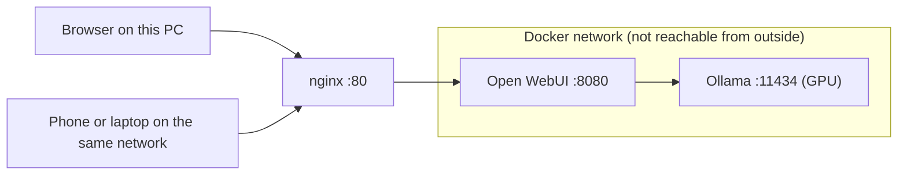
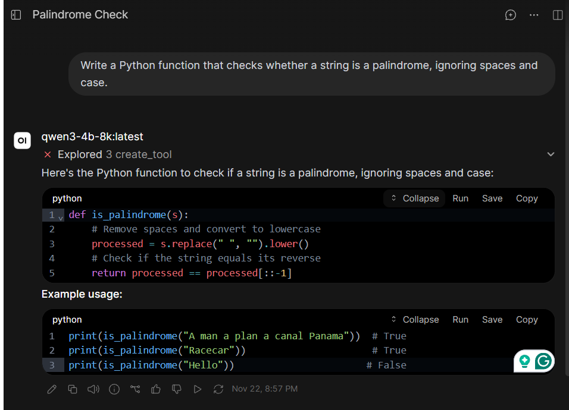
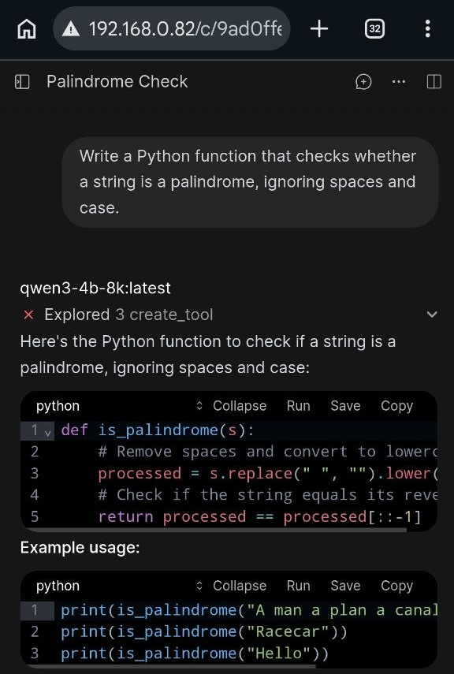

---
date:
  created: 2026-11-24
categories:
  - Engineering
slug: local-llm-stack
description: A private ChatGPT-style setup on one machine. Ollama runs an open-weight model on the GPU, Open WebUI gives it a chat interface, and nginx is the only door in. Then a tour of the open models people use for coding, and which of them fit on a 12 GB GPU.
tags:
  - LLM
  - Ollama
  - Docker
  - nginx
---

# Running a language model locally: Ollama, Open WebUI and nginx

A chat assistant doesn't have to live in someone else's data centre. An open-weight model, a GPU with a few gigabytes of memory and three containers are enough for a private assistant that answers in your browser, works offline and never sends a prompt anywhere. This post builds that setup step by step with one small model. It then introduces the open models that are popular for coding, and shows which of them fit on an ordinary graphics card.

<!-- more -->

## The three pieces

- **Ollama** loads a model file, runs it on the GPU, and answers requests over an HTTP API. It is the engine.
- **Open WebUI** is the chat interface: conversations, a model picker, file uploads, user accounts. It talks to Ollama's API.
- **nginx** is a reverse proxy in front of Open WebUI. It is the only service with a port open to the outside, so the rest of the stack stays on Docker's internal network.



The machine here is a Windows PC with Docker Desktop (WSL 2), an RTX 4070 with 12 GB of VRAM, and the NVIDIA driver. The same files work on Linux with Docker and the NVIDIA Container Toolkit. All the files in this post are in the [`01-local-llm-stack`](https://github.com/SaeedTaghavi/ai-projects/tree/main/01-local-llm-stack) folder of my `ai-projects` repository.

## Step 1: the compose file

```yaml title="compose.yml"
services:
  ollama:
    image: ollama/ollama:0.40.17
    environment:
      OLLAMA_CONTEXT_LENGTH: "8192"
      OLLAMA_KEEP_ALIVE: "10m"      # unload the model after 10 idle minutes
    volumes:
      - ollama:/root/.ollama        # downloaded models live here
    deploy:
      resources:
        reservations:
          devices:
            - driver: nvidia
              count: all
              capabilities: [gpu]
    restart: unless-stopped

  open-webui:
    image: ghcr.io/open-webui/open-webui:v0.13.4
    environment:
      OLLAMA_BASE_URL: http://ollama:11434
      WEBUI_SECRET_KEY: change-me-to-a-long-random-string
    volumes:
      - open-webui:/app/backend/data  # accounts, chats, settings
    depends_on:
      - ollama
    restart: unless-stopped

  nginx:
    image: nginx:1.29
    ports:
      - "80:80"
    volumes:
      - ./nginx:/etc/nginx/conf.d:ro
    depends_on:
      - open-webui
    restart: unless-stopped

volumes:
  ollama:
  open-webui:
```

Notice what is *not* there: Ollama and Open WebUI have no `ports:` section. They can reach each other by service name on the compose network, but nothing outside Docker can reach them. Ollama's API has no authentication, so this matters. Anyone who can reach port 11434 can run your models.

The `deploy.resources` block gives the Ollama container the GPU. Without it, Ollama still works, but on the CPU and many times slower.

## Step 2: nginx

```nginx title="nginx/default.conf"
map $http_upgrade $connection_upgrade {
    default upgrade;
    ''      close;
}

server {
    listen 80 default_server;
    server_name _;
    server_tokens off;

    client_max_body_size 50m;          # document and image uploads

    location = /healthz {
        access_log off;
        default_type text/plain;
        return 200 "ok\n";
    }

    location / {
        proxy_pass http://open-webui:8080;

        # Open WebUI keeps a WebSocket open (Socket.IO at /ws/socket.io)
        proxy_http_version 1.1;
        proxy_set_header Upgrade    $http_upgrade;
        proxy_set_header Connection $connection_upgrade;

        proxy_set_header Host              $host;
        proxy_set_header X-Real-IP         $remote_addr;
        proxy_set_header X-Forwarded-For   $proxy_add_x_forwarded_for;
        proxy_set_header X-Forwarded-Proto $scheme;

        # send tokens to the browser as they are generated
        proxy_buffering off;
        proxy_cache off;

        # a long answer from a slow model can take minutes
        proxy_read_timeout 600s;
        proxy_send_timeout 600s;
    }
}
```

Two settings matter for a chat interface specifically:

- **WebSocket upgrade.** The `map` block and the `Upgrade`/`Connection` headers let the browser's WebSocket connection pass through. Without them, the page loads but live updates break.
- **No buffering.** By default nginx collects the whole upstream response before sending it on. With `proxy_buffering off`, each token reaches the browser as soon as the model produces it, so the answer appears word by word instead of all at once at the end.

Start everything:

```bash
docker compose up -d
```

Open WebUI needs a minute or two on its first start. Then check each layer through nginx:

```console
$ curl http://localhost/healthz          # nginx itself
ok

$ curl http://localhost/health           # Open WebUI, through nginx
{"status":true}

$ curl -i -H "Connection: Upgrade" -H "Upgrade: websocket" \
       -H "Sec-WebSocket-Version: 13" -H "Sec-WebSocket-Key: dGhlIHNhbXBsZSBub25jZQ==" \
       "http://localhost/ws/socket.io/?EIO=4&transport=websocket"
HTTP/1.1 101 Switching Protocols         # the WebSocket passes through nginx
```

And confirm that only nginx is published:

```console
$ docker compose port nginx 80
0.0.0.0:80
$ docker compose port ollama 11434
:0                                       # not published
```

## Step 3: a model

For a first model, pick something small that fits easily in VRAM. I use **Qwen3 4B**: 2.5 GB on disk, multilingual, good at code for its size, and able to call tools. Pull it with:

```bash
docker compose exec ollama ollama pull qwen3:4b
```

!!! tip "If `ollama pull` hangs"
    Ollama's registry serves model files from Cloudflare R2. On some networks that host is unreachable, and the pull sits on "pulling manifest" or at 0 bytes. Ollama can pull the same model as a GGUF file from Hugging Face instead:

    ```bash
    docker compose exec ollama ollama pull hf.co/Qwen/Qwen3-4B-GGUF:Q4_K_M
    docker compose exec ollama ollama cp hf.co/Qwen/Qwen3-4B-GGUF:Q4_K_M qwen3:4b
    ```

    If you already downloaded a model in another Ollama volume, you can copy its files across instead of downloading them again: one manifest file plus the blobs it lists.

### Check how much memory it really takes

`ollama ps` shows where a loaded model runs and how much memory it holds:

```console
$ docker compose exec ollama ollama ps
NAME        SIZE      PROCESSOR    CONTEXT
qwen3:4b    9.0 GB    100% GPU     40960
```

A 2.5 GB model taking 9 GB is surprising. The reason is the **context window**. Ollama reserves memory for the KV cache, the model's working memory of the conversation, in proportion to the context length. This GGUF ships with `num_ctx 40960` in its own parameters, and a model's parameter overrides the server-wide `OLLAMA_CONTEXT_LENGTH`:

```console
$ docker compose exec ollama ollama show qwen3:4b --parameters
num_ctx       40960
temperature   0.6
top_k         20
top_p         0.95
…
```

A Modelfile creates a variant with a smaller window, and it reuses the same weights without copying them:

```dockerfile title="Modelfile"
FROM qwen3:4b
PARAMETER num_ctx 8192
```

```console
$ docker compose exec -T ollama sh -c "cat > /tmp/Modelfile && ollama create qwen3-4b-8k -f /tmp/Modelfile" < Modelfile
using existing layer sha256:7485fe6f…
creating new layer sha256:c066253d…
success

$ docker compose exec ollama ollama ps
NAME                  SIZE      PROCESSOR    CONTEXT
qwen3-4b-8k:latest    3.9 GB    100% GPU     8192
```

From 9.0 GB to 3.9 GB. That leaves room for a second model, or for a bigger one. 8,192 tokens is plenty for chat and for most single-file coding questions. Raise it when you paste long documents.

### How fast is it

Ollama's API returns timing for every request. A small script, run inside the Open WebUI container because that one can reach Ollama, asks for a Fibonacci function and prints the numbers:

```python title="scripts/bench.py"
import json, urllib.request

req = {"model": "qwen3-4b-8k",
       "prompt": "Write a Python function that returns the n-th Fibonacci number iteratively. Code only. /no_think",
       "think": False,      # neither this nor /no_think stopped the thinking with this GGUF
       "stream": False}
r = urllib.request.urlopen(urllib.request.Request(
    "http://ollama:11434/api/generate", json.dumps(req).encode(),
    {"Content-Type": "application/json"}), timeout=600)
d = json.load(r)
s = 1e9
print(f"prompt      {d['prompt_eval_count']} tokens in {d['prompt_eval_duration']/s:.2f} s")
print(f"generation  {d['eval_count']} tokens in {d['eval_duration']/s:.2f} s"
      f" = {d['eval_count']/(d['eval_duration']/s):.1f} tokens/s")
print(f"total       {d['total_duration']/s:.2f} s")
```

```console
$ docker compose exec -T open-webui python - < scripts/bench.py
prompt      31 tokens in 0.06 s
generation  1723 tokens in 14.23 s = 121.1 tokens/s
total       16.13 s
```

About 120 tokens per second is far faster than anyone reads. But note the token count: 1,723 tokens for a function of ten lines. Qwen3 is a *thinking* model. Before answering, it reasons at length inside `<think>` tags, testing the function by hand for n = 0, 1, 2, 3… That makes its answers better, but slower. Open WebUI folds the reasoning into a collapsible "Thought" section, so you only see the answer unless you open it.

With this Hugging Face file, neither Ollama's `think: false` option nor Qwen's `/no_think` switch turned the thinking off. If you want short, immediate answers, choose a non-thinking *instruct* or *coder* model from the list below.

## Step 4: use it

Open `http://localhost`. The first account you create becomes the administrator. Pick the model at the top of a new chat, here `qwen3-4b-8k`, and start typing:



To use it from a phone or another computer on the same network, open `http://<this PC's IP address>` instead, for example `http://192.168.0.82`. On Windows, find the address with `ipconfig`. The same chat, from a phone on the same Wi-Fi:

{ width="360" }

If other devices can't connect, Windows Firewall is probably blocking inbound port 80. Allow it for *private* networks only, never public ones.

### The model tried to write a tool

Both screenshots show a line above the answer: **✕ Explored 3 create_tool**. Before writing the five-line function, the model called one of Open WebUI's *built-in tools* three times. Each call failed, and then it answered normally.

`create_tool` is offered only to administrators. It saves a new Python tool into the workspace, and its own description in Open WebUI's source says that saving executes the Python module on the server. Here the model's code didn't have the structure Open WebUI expects, so nothing was created. Still, a small model reaching for a tool that runs code on the server, just to answer a simple question, is not what you want.

Open WebUI attaches its built-in tools to models with native function calling. For a plain chat or coding assistant, turn off the ones you don't need under **Admin Panel → Settings → Models → (your model) → Builtin Tools**. Better still, use a normal, non-admin account for everyday chatting.

!!! warning "Only on networks you trust"
    This setup uses plain HTTP and is meant for a home or lab network. Open WebUI's accounts protect the chat, but traffic isn't encrypted. Before exposing it beyond your local network, put TLS in front of nginx, and don't publish Ollama's port at all.

If you want an editor extension to talk to Ollama directly, publish its port on the loopback address only, so it is reachable from this machine but not from the network:

```yaml
  ollama:
    ports:
      - "127.0.0.1:11434:11434"
```

## Open models for coding

Qwen3 4B is a good general start. For programming there are models trained specifically on code, and several are built to work as *agents* that read a repository, call tools and edit several files. The table lists well-known ones as they appear in Ollama's library in November 2026. Sizes are the download size of the default 4-bit build. As a rough rule, a model runs entirely on the GPU if its file is clearly smaller than the VRAM, with room left for the context.

!!! tip "Check before you download"
    [canirun.ai](https://canirun.ai/) estimates this for you. It detects your GPU (or Mac) in the browser and sorts open models into "can run", "tight fit" and "too heavy". For each model it shows the size at each quantization level, from 2-bit up to 16-bit, so you can see whether a smaller quantization would make a model fit. It is a quick way to avoid a 20 GB download that won't fit your card.

### Fits on a 12 GB GPU

| Model | Publisher | Sizes (download) | Context | Notes |
|---|---|---|---|---|
| `qwen2.5-coder` | Alibaba Qwen | 0.5b · 1.5b · 3b (1.9 GB) · 7b (4.7 GB) · 14b (9.0 GB) | 32K | The usual first choice for local coding. The full range of sizes, tool calling, and good at completing code inside a file. |
| `deepseek-coder-v2` | DeepSeek | 16b (8.9 GB) | 160K | Mixture-of-experts: 16B parameters, only a fraction active per token, so it is fast for its size. |
| `deepcoder` | Agentica, Together AI | 1.5b · 14b (9.0 GB) | 128K | A reasoning model tuned on competitive-programming problems. |
| `starcoder2` | BigCode | 3b (1.7 GB) · 7b · 15b (9.1 GB) | 16K | Trained on openly licensed code with a published dataset. Made for code completion rather than chat. |
| `codegemma` | Google | 2b · 7b (5.0 GB) | 8K | Small and quick, good for completion. |
| `granite-code` | IBM | 3b (2.0 GB) · 8b (4.6 GB) | 125K | IBM's code family, trained for enterprise use. |
| `mimo-v2.6` | Xiaomi | 9b (6.6–8.7 GB) | 256K | Recent. Code and agent workflows, MIT licence. |
| `codellama` | Meta | 7b · 13b (7.4 GB) | 16K | Historically important, now overtaken by the models above. |

### Bigger: partly on the CPU, or a larger GPU

| Model | Publisher | Size (download) | Context | Notes |
|---|---|---|---|---|
| `qwen3-coder` | Alibaba Qwen | 30b (19 GB) | 256K | Mixture-of-experts with about 3.3B active parameters. It doesn't fit in 12 GB, but because so few parameters are active per token it stays usable with part of it in system RAM. Built for agentic coding. |
| `devstral` / `devstral-small-2` | Mistral AI | 24b (14–15 GB) | 128K / 384K | Made for coding agents that explore a codebase and edit several files. Apache 2.0. |
| `gpt-oss` | OpenAI | 20b (14 GB) | 128K | A general reasoning model rather than a code model, but strong at code and tool use. Apache 2.0. |
| `codestral` | Mistral AI | 22b (13 GB) | 32K | Mistral's first code model. Check its licence before any commercial use. |
| `glm-4.7-flash` | Z.ai | 19 GB | 198K | Recent 30B-class model with tools and thinking. Needs a recent Ollama. |
| `north-mini-code-1.0` | Cohere | 19 GB | 256K | Recent mixture-of-experts code model, 3B active. |

A few practical points when choosing:

- **Chat or completion.** Instruct and chat models (`qwen2.5-coder`, `devstral`, `deepseek-coder-v2`) answer questions and write functions on request. Base models such as `starcoder2` are best at filling in code as you type, through an editor extension.
- **Thinking or not.** Reasoning models (`qwen3`, `deepcoder`, `gpt-oss`) are more careful and much slower per answer. For autocomplete and quick questions, a non-thinking model feels far more responsive.
- **Licences differ.** Many are Apache 2.0 or MIT, but some carry their own terms. Check the model card before you build anything commercial on top of it.
- **Bigger isn't automatically better locally.** A 7B model entirely on the GPU is often more pleasant to use than a 30B model that spills into system RAM.

To try one, pull it and pick it in Open WebUI:

```bash
docker compose exec ollama ollama pull qwen2.5-coder:7b
```

## Summary

Three containers give you a private, offline chat assistant: Ollama for the model, Open WebUI for the interface, nginx as the single entry point. The details that made the difference in practice were all about memory and networking:

- keep Ollama off the network;
- let WebSockets through nginx and turn off buffering;
- check `ollama ps` to see what a model really costs in VRAM, and shrink the context with a Modelfile when a model asks for more than it needs.

From there, swapping in a coding model is one `ollama pull` away.
