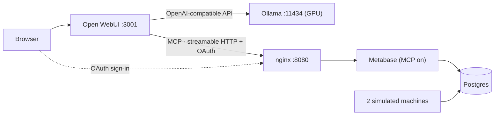
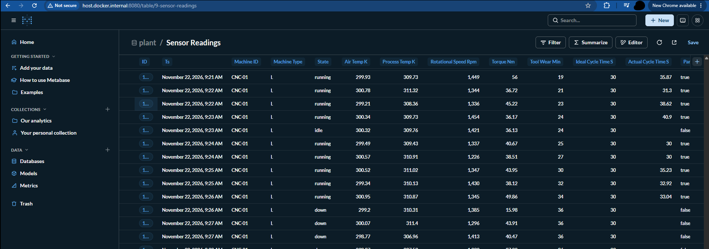
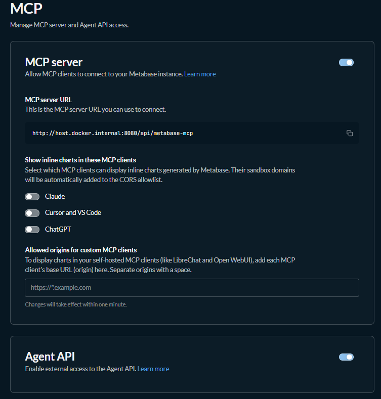
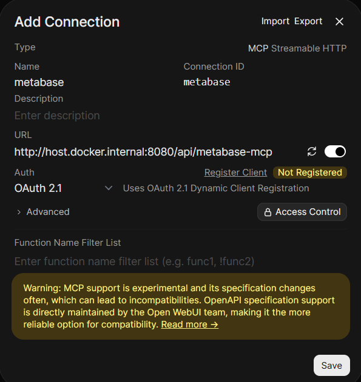
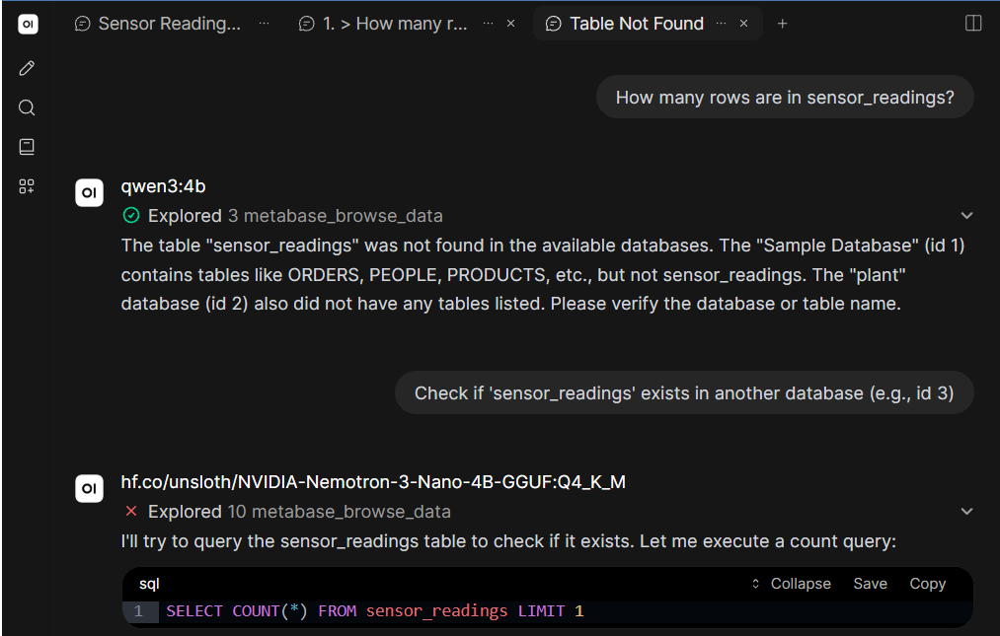

---
date:
  created: 2026-11-25
categories:
  - Engineering
slug: local-llms-metabase-mcp
description: What the Model Context Protocol is and what it is used for, then a step-by-step build of a local lab. Metabase's built-in MCP server behind an nginx reverse proxy, queried through OAuth by small open-weight models running in Ollama and Open WebUI on one 12 GB GPU.
cover: img/local-llms-metabase-mcp-cover.png
tags:
  - MCP
  - Metabase
  - Ollama
  - LLM
  - Docker
---

# MCP on one machine: local models, Metabase and an nginx proxy

A language model on its own can only answer from what it saw during training. To answer "how many parts did press 1 reject last night?", it needs to reach a database, run a query and read the result. The Model Context Protocol, MCP, is a standard way to give a model that reach. This post explains what MCP is and what it is used for. Then it builds a complete lab on one machine: Metabase's MCP server behind the nginx proxy from a Hamravesh guide, and small open-weight models in place of a cloud model, with every config file and command needed to repeat it.

<!-- more -->

## What MCP is

MCP is an open protocol, published by Anthropic in November 2024, for connecting AI applications to outside data and tools. Before MCP, every chat app that wanted to talk to a database, a file system or an issue tracker needed its own custom integration for each one. MCP replaces those with a single interface. A tool provider writes one MCP server, and any application that speaks MCP can use it.

The protocol has three roles:

- **The host** is the application the person uses: a chat interface, an IDE, a coding agent.
- **The client** lives inside the host and holds one connection to one server.
- **The server** exposes capabilities. It can offer *tools*, which are actions the model can call, such as "run this query". It can offer *resources*, which are data the application can read. It can also offer *prompts*, which are reusable templates.

The model itself is none of these. It sits behind the host and decides which tool to call and with which arguments. The host carries out the call through the client, and the result goes back to the model as text. That split is useful when something goes wrong. An MCP server can be working perfectly while the model using it gets the answer wrong.

Messages are JSON-RPC. They travel over one of two transports. **stdio** is used when the host starts the server as a local process and talks to it through standard input and output. **Streamable HTTP** is used when the server runs somewhere else and is reached at a URL. Remote servers usually protect themselves with OAuth, so the user signs in once and the client gets a token.

## What it is used for

Anything with an API can sit behind an MCP server. Some common uses:

- **Coding.** IDEs and coding agents use MCP servers to read issues, open pull requests, search documentation or query a staging database while they work on code.
- **Data and BI.** A server in front of a database or a BI tool lets someone ask a question in plain language and get a query, a number or a chart back. Metabase, the subject of this post, ships its own server.
- **Internal knowledge.** Servers for wikis, ticket systems and shared drives let an assistant answer from a company's own documents instead of from its training data.
- **Operations.** Servers for Kubernetes, CI systems and monitoring let an agent inspect a cluster or a failing pipeline.
- **Research.** The same idea works for a lab: a server in front of a database of simulation runs, or of experiment metadata, lets you ask "which parameter sets gave gamma oscillations above 40 Hz?" without writing the SQL yourself.

In every case, the server decides what the model is allowed to see and do. The model only gets the tools the server exposes, with the permissions of the user who signed in.

## The guide this follows

Hamravesh, an Iranian cloud provider, published a guide on [connecting Metabase's MCP server to Claude through a reverse proxy](https://docs.hamravesh.com/guides/metabase-mcp-reverse-proxy). The problem it solves is a network one. A Metabase instance inside a restricted network can't be reached by Claude's servers. So the guide puts an nginx proxy on a public domain outside that network, points Metabase's site URL at the proxy, and gives Claude the proxy's address.

This post rebuilds the same setup on one machine and replaces Claude with local models. Nothing leaves the machine.

## The lab



It runs in Docker Compose on Windows with Docker Desktop (WSL 2), an RTX 4070 with 12 GB of VRAM, and 128 GB of RAM. The complete lab is in the [`02-mcp-metabase`](https://github.com/SaeedTaghavi/ai-projects/tree/main/02-mcp-metabase) folder of my `ai-projects` repository: compose file, nginx config, simulator, test questions and the raw results of every run. If you'd rather start without models and tools, the [previous post](local-llm-stack.md) sets up Ollama, Open WebUI and nginx on their own.

| Component | Image | Role |
|---|---|---|
| Postgres | `postgres:16` | The data |
| Sensor simulator | built locally | Writes one row per machine per second |
| Metabase | `metabase/metabase:v0.65.6.3` | BI tool and MCP server |
| nginx | `nginx:1.29` | The reverse proxy from the guide |
| Ollama | `ollama/ollama:0.40.17` | Runs the models on the GPU |
| Open WebUI | `ghcr.io/open-webui/open-webui:v0.13.4` | Chat interface and MCP client |

The data comes from a small simulator I wrote for an [earlier Metabase tutorial](https://github.com/SaeedTaghavi/metabase-postgres-tutorial). Two simulated machines, a CNC and a press, insert a row into a `sensor_readings` table every second: temperatures, speed, torque, tool wear, state (`running`, `idle`, `down`) and whether each part passed inspection.

## Step 1: the compose file

The parts that matter for MCP are Metabase, nginx, Ollama and Open WebUI. Postgres and the simulator are ordinary services and are left out here.

```yaml title="compose.yml (excerpt)"
services:
  metabase:
    image: metabase/metabase:v0.65.6.3
    environment:
      MB_DB_FILE: /metabase-data/metabase.db
      MB_SITE_URL: http://host.docker.internal:8080   # every OAuth client is sent here
    volumes:
      - mbdata:/metabase-data
    expose:
      - "3000"            # reached only through nginx, as in the guide

  nginx:
    image: nginx:1.29
    ports:
      - "8080:80"
    volumes:
      - ./nginx:/etc/nginx/conf.d:ro

  ollama:
    image: ollama/ollama:0.40.17
    ports:
      - "11434:11434"
    environment:
      OLLAMA_CONTEXT_LENGTH: "16384"
      OLLAMA_DEBUG: "1"    # logs the prompt size of every request
    volumes:
      - ollama:/root/.ollama
    deploy:
      resources:
        reservations:
          devices:
            - driver: nvidia
              count: all
              capabilities: [gpu]

  open-webui:
    image: ghcr.io/open-webui/open-webui:v0.13.4
    ports:
      - "3001:8080"
    environment:
      OLLAMA_BASE_URL: http://ollama:11434
      WEBUI_URL: http://localhost:3001
      WEBUI_SECRET_KEY: local-lab-change-me   # keeps stored OAuth tokens valid across restarts
      AIOHTTP_CLIENT_TIMEOUT_TOOL_SERVER: "300"
    extra_hosts:
      - "host.docker.internal:host-gateway"
    volumes:
      - openwebui:/app/backend/data
```

### One name for every client

`MB_SITE_URL` was the setting that needed the most thought. When a client first calls the MCP endpoint without a token, Metabase answers `401` with a header pointing at its OAuth metadata, and that address is built from the site URL. In this lab three different things must reach it: the browser for the sign-in page, tools running on the host, and Open WebUI's backend in a container. `localhost` means something different inside a container, and `metabase:3000` doesn't resolve on the host.

`host.docker.internal` works for all three. Docker Desktop writes it into the Windows hosts file, and containers resolve it to the host. On Linux without Docker Desktop, the `extra_hosts` line does the same for containers, and you would add the name to `/etc/hosts` yourself.

## Step 2: the proxy

This is the guide's nginx config with three changes, because the upstream is a container on the same Docker network instead of a public HTTPS domain:

```nginx title="nginx/default.conf"
server {
    listen 80;
    server_name host.docker.internal localhost;
    server_tokens off;

    access_log /dev/stdout;
    error_log  /dev/stderr;
    client_max_body_size 10m;

    location = /healthz {
        access_log off;
        default_type text/plain;
        return 200 "ok\n";
    }

    location / {
        proxy_pass http://metabase:3000;            # guide: https://<metabase-domain>

        proxy_http_version 1.1;
        proxy_set_header Connection "";

        proxy_set_header Host              $http_host;   # guide: the upstream domain
        proxy_set_header X-Forwarded-Host  $http_host;
        proxy_set_header X-Forwarded-Proto http;         # guide: https / 443
        proxy_set_header X-Forwarded-Port  8080;
        proxy_set_header X-Forwarded-For   $proxy_add_x_forwarded_for;

        # needed for streamed MCP responses
        proxy_buffering off;
        proxy_cache off;

        proxy_connect_timeout 15s;
        proxy_read_timeout    3600s;
        proxy_send_timeout    3600s;
    }
}
```

The guide's `proxy_ssl_server_name` and `proxy_ssl_name` lines are gone, since there is no TLS to the upstream. Everything that matters for streaming stays: HTTP/1.1 to the upstream, no buffering, no cache and long timeouts.

Start the stack:

```bash
docker compose up -d --build
```

## Step 3: switch on Metabase's MCP server

Open `http://host.docker.internal:8080`, finish Metabase's setup wizard, and add the Postgres database. Metabase runs in its own container, so the host is the service name `postgres` and the port is the container port `5432`:

```text
jdbc:postgresql://postgres:5432/plant?user=sensors&password=sensors_pw
```



The address bar already shows two details that matter later. Metabase is reached through the proxy at `host.docker.internal:8080`, and the table's ID is `9`.

Then go to **Admin → AI → MCP** and switch the server on. According to [Metabase's documentation](https://www.metabase.com/docs/latest/ai/mcp), it is available on every plan, including the free open-source edition, and it needs no AI provider configured in Metabase, because the client brings the model. The page shows the server URL, which comes from `MB_SITE_URL`. Add Open WebUI's address, `http://localhost:3001`, under **Allowed origins for custom MCP clients** so it is allowed to show Metabase's charts.



Now run the guide's two checks through the proxy:

```console
$ curl -i http://host.docker.internal:8080/healthz
HTTP/1.1 200 OK
Server: nginx

ok

$ curl -i -H "Accept: application/json, text/event-stream" \
       http://host.docker.internal:8080/api/metabase-mcp
HTTP/1.1 401 Unauthorized
Server: nginx
WWW-Authenticate: Bearer realm="mcp",
  resource_metadata="http://host.docker.internal:8080/.well-known/oauth-protected-resource/api/metabase-mcp",
  scope="agent:content:read agent:query:run agent:content:write agent:sql:run agent:delivery:write"
x-metabase-version: v0.65.6.3

{"jsonrpc":"2.0","id":null,"error":{"code":-32603,"message":"Authentication required"}}
```

The `-32603 Authentication required` error is the expected answer for a request without a token. The `WWW-Authenticate` header is worth reading too. `resource_metadata` already uses `host.docker.internal:8080`, which confirms that `MB_SITE_URL` reached Metabase. The `scope` list shows the five permissions a client can ask for.

## Step 4: the models

Pick models that support tool calling. I used four small ones, quantized to Q4_K_M: `qwen3:4b`, `llama3.2:3b`, NVIDIA's `nemotron-3-nano:4b` and `qwen3:8b`.

The normal command is `ollama pull qwen3:4b`. On my network it hung on "pulling manifest" and then sat at zero bytes. Ollama's registry serves model files from Cloudflare R2 (`*.r2.cloudflarestorage.com`), and that host was unreachable from both Windows and Docker. If that happens to you, check it directly:

```bash
curl -s -o /dev/null -w "%{http_code}\n" -m 15 https://registry.ollama.ai/v2/   # works
curl -s -o /dev/null -w "%{http_code}\n" -m 15 https://<bucket>.r2.cloudflarestorage.com/   # times out
```

Hugging Face was reachable, and Ollama can pull GGUF files from it directly. Copy each one to a short name afterwards:

```bash
docker compose exec ollama ollama pull hf.co/Qwen/Qwen3-4B-GGUF:Q4_K_M
docker compose exec ollama ollama cp hf.co/Qwen/Qwen3-4B-GGUF:Q4_K_M qwen3:4b

docker compose exec ollama ollama pull hf.co/Qwen/Qwen3-8B-GGUF:Q4_K_M
docker compose exec ollama ollama cp hf.co/Qwen/Qwen3-8B-GGUF:Q4_K_M qwen3:8b
```

The copy shares the same files, so it takes no extra disk space. Confirm that the model supports tools:

```console
$ curl -s http://localhost:11434/api/show -d '{"model":"qwen3:4b"}' | jq -c .capabilities
["completion","tools","thinking"]
```

!!! warning "Chat templates from Hugging Face"
    A GGUF from Hugging Face brings its own chat template. For the Qwen and Llama models it worked as expected. For the Nemotron file, Ollama didn't recognize its thinking tags, and a raw `</think>` tag appeared in the model's answers.

## Step 5: connect Open WebUI to the MCP server

Open `http://localhost:3001` and create the local admin account. Then go to **Admin Panel → Settings → Integrations → External Tool Servers** and add a connection:

| Field | Value |
|---|---|
| Type | MCP Streamable HTTP (click the type label to switch from OpenAPI) |
| Name / ID | `metabase` |
| URL | `http://host.docker.internal:8080/api/metabase-mcp` |
| Auth | OAuth 2.1 |
| Function Name Filter List | `browse_data,search,execute_query,execute_sql` |

Click **Register Client** before saving. Open WebUI then uses OAuth Dynamic Client Registration to register itself with Metabase, and the label changes from "Not Registered" to "Registered".



The first time the tool is used in a chat, Open WebUI sends you to Metabase's consent page. After you approve, it stores the token. The whole OAuth exchange is visible in nginx's log:

```console
$ docker compose logs nginx | grep -E "oauth|well-known|metabase-mcp"   # trimmed
"POST /api/metabase-mcp HTTP/1.1" 401                                    # no token yet
"GET /.well-known/oauth-protected-resource/api/metabase-mcp HTTP/1.1" 200
"GET /.well-known/oauth-authorization-server HTTP/1.1" 200
"POST /oauth/register HTTP/1.1" 201                                      # Register Client
"GET /oauth/authorize?response_type=code&client_id=7cda480e-… HTTP/1.1" 302
"GET /oauth/authorize?… HTTP/1.1" 200                                    # consent page
"POST /oauth/authorize/decision HTTP/1.1" 302                            # you click approve
"POST /oauth/token HTTP/1.1" 200
"POST /api/metabase-mcp HTTP/1.1" 200                                    # tool calls with the token
```

Finally, in a new chat:

1. Pick the model.
2. Under **Controls → Advanced Params**, set **Function Calling** to **Native**.
3. Click **+**, then under **Tools** turn on **metabase**.

### Why the filter list

The filter isn't optional for small models. Every tool an MCP server exposes is sent to the model with every request, as text. Without the filter, Metabase's twenty-odd tools plus Open WebUI's built-in tools made the prompt for "How many rows are in sensor_readings?" **30,492 tokens** long. `qwen3:8b` spent two minutes thinking and never called a tool. Its reasoning went in a circle that it never broke:

> So the correct approach is to call browse_data to get the list of tables, then extract the ID for sensor_readings… But since the user's question is just asking for the count… the assistant should first call the execute_query function… However, without the table ID, this is not possible.

It knew the right plan and repeated it about ten times, then ended its turn without taking the first step. With the four tools above, the same prompt was **9,661 tokens**, and the same model found the table and counted the rows.

You can measure this yourself, because with `OLLAMA_DEBUG=1` Ollama logs the prompt size of every request:

```console
$ docker compose logs ollama | grep task.n_tokens
… new prompt, task.n_tokens = 30492      # all tools
… new prompt, task.n_tokens = 9661       # filter list on
```

## What a tool call looks like

In the chat, each answer starts with a line such as "Explored 3 metabase_browse_data", which names the tools the model called. Here `qwen3:4b` and then `nemotron-3-nano:4b` both decide that `sensor_readings` doesn't exist. Nemotron even writes the right SQL, but as text in its answer; it never sends it to `execute_sql`:



Expand that line and Open WebUI's **View Result** panel shows the exact input and output of each call. It is the first place to look when an answer is wrong. This is `qwen3:4b` listing the tables of the `plant` database:

```text title="metabase_browse_data: input"
action       list_tables
database_id  2
schema       ""
```

```json title="output"
{"data": [], "returned": 0, "total": 0}
```

The list is empty, yet the table exists. In Postgres the table lives in the `public` schema, and the empty `schema` argument matched nothing. Called again with `schema: "public"`, the same tool returns it:

```json
{"data": [{"id": 9, "name": "sensor_readings", "display_name": "Sensor Readings",
           "schema": "public", "db_id": 2, "description": null}],
 "returned": 1, "total": 1}
```

The model then wrote an MBQL query by itself, using the table ID it had just learned:

```json title="metabase_execute_query: input"
{"lib/type": "mbql/query",
 "stages": [{"lib/type": "mbql.stage/mbql",
             "source-table": 9,
             "aggregation": [["count", {}]]}]}
```

```json title="output"
{"cols": [{"name": "count", "base_type": "type/BigInteger"}],
 "rows": [[11250]]}
```

The count matched `psql` on the same table, allowing for the rows the simulators had added in between.

The 4B model got the empty list, believed it, and told me the table didn't exist. The 8B model got the same empty list, tried other calls, and found the table without help. The server answered every call correctly. The difference was in what each model did with the answer.

## Lessons for running MCP locally

- **Check the server before blaming the model.** The two `curl` checks and nginx's log show whether the proxy, OAuth and the MCP endpoint work. The **View Result** panel shows whether a wrong answer came from the data or from the model.
- **Check which tool was called.** In my first chat the OAuth sign-in wasn't finished, so the Metabase tools weren't attached. `llama3.2:3b` called Open WebUI's built-in `list_knowledge_bases` instead, got nothing back, and answered with generic instructions and an SQL query it never ran. It didn't say that it had no access. The "Explored …" line would have shown the wrong tool name at once.
- **Make the site URL reachable from every client.** With OAuth, every client follows `MB_SITE_URL`. `host.docker.internal` is the simplest name that works on the host and in containers.
- **Filter the tool list.** Every tool description is part of the prompt. Keep only what the task needs.
- **Watch for empty results.** An empty list looks like a valid answer. A system prompt such as "if a listing is empty, try `search` before concluding that something doesn't exist" helps small models.
- **Have a fallback for model downloads.** If `ollama pull` hangs, check whether R2 is reachable and pull the GGUF from Hugging Face instead.
