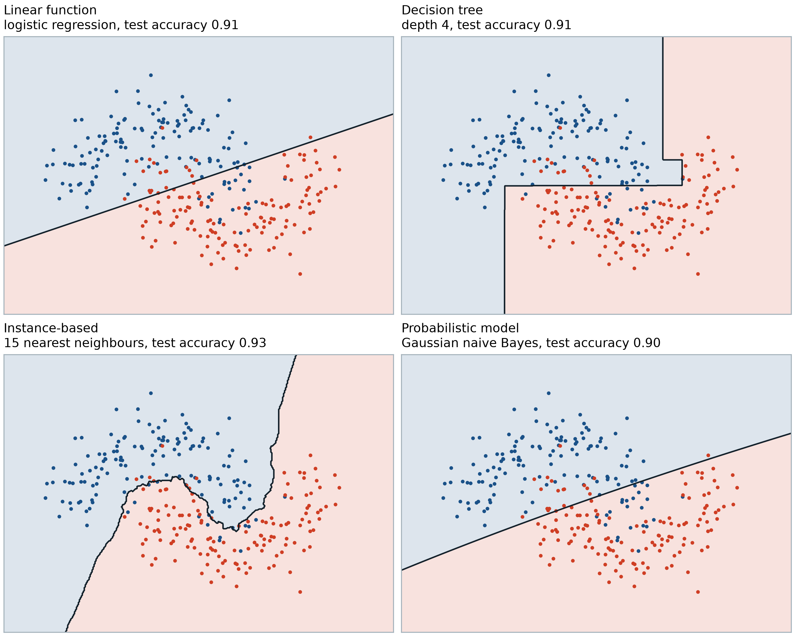

---
date:
  created: 2026-11-22
categories:
  - Machine learning
slug: machine-learning-notes-01-introduction
description: "First of a series of notes on machine learning: the kinds of learning, how a learning system is designed, and the three parts of every learning algorithm."
cover: img/ml-intro-cover.png
tags:
  - Machine learning
  - Series
---

# Machine learning notes, part 1: what learning means

I am reading my way through machine learning again, from the beginning, and writing notes as I go. This is the first of them. It covers the vocabulary that everything later builds on: what changes when a program learns, the kinds of learning, how a learning system is designed, and the three parts that every learning algorithm has. One example runs through all of it: recognising the handwritten digits of MNIST.

<!-- more -->

## A change of viewpoint

In ordinary programming we write the rules. The program takes data in and produces output, and if the output is wrong we fix the rules. Machine learning turns this around. We have the data and we have the output we want for it, and what we are looking for is the program.

<figure markdown="span">
  
  <figcaption>Traditional programming runs a program on data. Machine learning starts from data and the answers, and learns the program.</figcaption>
</figure>

Handwritten digits show why this matters. Nobody can write down the rules that make a scribble a 7 and not a 1: people write sevens with and without a bar, slanted or upright, thick or thin. But it is easy to collect thousands of sevens and say "these are sevens". MNIST is exactly that: 70,000 greyscale images of 28 × 28 pixels, each labelled with the digit it shows, split into 60,000 for training and 10,000 for testing.

Tom Mitchell's textbook gives the standard definition. A program learns from experience E with respect to a task T and a performance measure P if its performance at T, measured by P, improves with E. For us, T is reading a digit from an image, P is the fraction of test images read correctly, and E is the 60,000 labelled training images.

## Kinds of learning

Learning problems differ mainly in what the learner is told about each example.

**Supervised learning.** Every training example comes with the right answer. MNIST as it is published is a supervised problem: images and their labels, and the learner must map a new image to a label. When the answer is a category it is called classification; when it is a number, such as the price of a flat from its size and location, it is regression.

**Unsupervised learning.** There are no answers at all, only the data. Give a clustering algorithm the 60,000 images without their labels and it will still group them, because most sevens look more like each other than like a zero. The groups have no names, though, and some of them will not match digits: a cluster of thick, slanted strokes may mix ones and sevens. Clustering, dimensionality reduction and density estimation are the usual unsupervised tasks.

**Semi-supervised learning.** A few examples are labelled and many are not. Labels cost human time and unlabelled data is cheap, so this is the common case in practice. A classic benchmark keeps the labels of only 100 MNIST training images, ten per digit, and throws the other 59,900 labels away. One simple strategy is self-training: learn from the 100, label the unlabelled images the model is most confident about, add them to the training set and repeat.

**Strongly and weakly supervised learning.** This axis is about the quality of the labels rather than their number. Strong supervision gives exact and complete labels for the task: for a photo of a house number, a box around every digit and the digit inside it. Weak supervision gives labels that are coarser, noisier or incomplete: only the string "127" for the whole photo, with no boxes; labels produced by a heuristic instead of a person; or tags that users attached to images on the web. The learner has to work out the missing detail itself.

**Reinforcement learning.** There are no labels, only a reward that arrives after actions, often much later. An agent playing an Atari game or Go is never told which move was right; it learns from winning and losing. A robot learning to walk is rewarded for distance covered and punished for falling. The difficulty is credit assignment: deciding which of many actions earned the reward.

## Designing a learning system

Mitchell describes the design of a learning system as four choices, made in order. His example is a program that learns to play checkers. Here they are again for digits.

### 1. Choose the training experience

What will the learner see, and what feedback comes with it? The feedback can be direct, a label on every image, or indirect, like a checkers program that only learns at the end of a game whether it won. Someone has to choose the examples: a teacher, the learner itself by asking questions, or nobody, when the data are simply what happened to be collected. Above all, the training examples should look like the cases the system will meet later. For MNIST the experience is the 60,000 labelled images, chosen once and for all by the people who built the data set.

### 2. Choose exactly what is to be learned

This is the target function. The obvious choice is a function from an image to a digit, $f : \text{image} \to \{0, 1, \dots, 9\}$. A more useful choice is a score for each digit, $V(\text{image}, d) \in \mathbb{R}$, with the prediction taken as the digit with the highest score. Scores change smoothly when the model's parameters change, while a hard label jumps from one digit to another, so scores are much easier to optimise. They also say how sure the model is: if the scores for 4 and 9 are close, the image is ambiguous. Most classifiers today learn exactly this kind of function, usually with the scores turned into probabilities.

### 3. Choose how to represent the target function

The target function is an ideal; the learner can only search among the functions it is able to write down. The simplest representation for digits treats the image as 784 numbers, one per pixel, and gives each digit a weight vector:

$$
\hat V(x, d) = w_{d,0} + \sum_{i=1}^{784} w_{d,i}\, x_i .
$$

This linear model reads about 92% of MNIST test digits correctly. Alternatives are hand-made features, such as the number of loops and stroke ends, or a convolutional network that learns its own features and passes 99%. The trade-off is always the same. A more expressive representation can describe more of the truth, but it has more parameters to fit and needs more data to fit them.

### 4. Choose a learning algorithm

Finally, we need a procedure that uses the experience to set the parameters. Mitchell uses the least-mean-squares rule. For each training image, compare the score with the target (1 for the correct digit, 0 for the others) and nudge every weight to reduce the difference:

$$
w_{d,i} \leftarrow w_{d,i} + \eta \,\bigl(V_{\text{train}}(x, d) - \hat V(x, d)\bigr)\, x_i ,
$$

with a small learning rate $\eta$. This is gradient descent on the squared error, one example at a time, and the same idea, with a better error measure, trains today's networks.

## Training and test distributions

Everything above rests on an assumption that is easy to forget. We assume that the training and test examples are drawn independently from the same distribution. Under that assumption, good performance on the training data is evidence of good performance on new data. When it fails, it fails in two ways.

**The examples are not independent.** The digits of one ZIP code, the letters of one word or web pages that link to each other influence each other's labels. Classifying each one alone throws that information away. Classifying them together, so that the label of one can change the label of another, is called collective classification.

**The test distribution is different.** A model trained on one distribution and used on another needs transfer learning, also called domain adaptation. MNIST was itself built around this problem. NIST, the American standards institute, had collected two sets of digits: one written by Census Bureau employees and one written by high-school students. The employees' digits were cleaner and easier to read, so a model trained on one set and tested on the other gave misleading results. MNIST mixes the two sets in both its training and its test half, while keeping the people who wrote the training digits apart from those who wrote the test digits. The same shift shows up as soon as a model leaves the data set: in my [LeNet web app](lenet-web-app.md#what-the-network-sees), a photo of a digit on paper looks nothing like an MNIST image, and the network fails for that reason.

## So many algorithms

There are tens of thousands of machine learning algorithms, and hundreds of new ones are published every year. A few that come up again and again: k-nearest neighbours, naive Bayes, logistic regression, support vector machines, decision trees such as CART and C4.5, random forests, gradient boosting, k-means, principal component analysis, hidden Markov models, convolutional networks, transformers and Q-learning.

Learning them one by one is hopeless. Fortunately they are all built from the same three parts.

## Three components of every learning algorithm

Pedro Domingos put it in one line: learning = representation + evaluation + optimization. The representation defines what the learner can say. Evaluation decides which of those statements is good. Optimization searches for the best one.

### Representation

The representation is the language in which a model is written. Formally, it fixes the hypothesis space: the set of all functions the learner could ever return. A learner cannot learn a function it cannot express, however much data it sees. This is the most important choice of the three, because it decides what can be learned at all.

Every representation also comes with a preference, the inductive bias. Among functions that fit the training data equally well, it decides which one we get. A concept that is simple in one language can be impossibly complicated in another. Exclusive or, "one of the two inputs is on, but not both", is out of reach for any linear function, but a decision tree of depth two represents it exactly. Choosing a representation is choosing what the learner will find simple.

The main families, with how each would read a digit:

- **Numerical functions.** The model is a formula in numbers. Linear regression and the linear model above weigh pixels. A neural network stacks such weighted sums with non-linear steps between them, so it can build strokes from pixels and digits from strokes. A support vector machine draws the widest possible margin between classes, often after mapping the data to a space where they separate more easily.
- **Symbolic functions.** The model is a structure of logical tests. A decision tree asks one question at each node, "is pixel (14, 10) dark?", and the answers lead to a leaf with a digit. Rules in propositional logic say the same thing as lists: IF the centre is empty AND the top is dark THEN 0. Rules in first-order predicate logic can talk about parts and their relations: an image is a 6 if it contains a loop that lies below the end of a stroke. Symbolic models are the easiest to read and check.
- **Instance-based functions.** The model is the training data itself. To read a new image, find the stored images most similar to it and let them vote. k-nearest neighbours does this with no training step at all, and on MNIST it reads about 97% of the test digits correctly. All the work moves to the choice of what "similar" means.
- **Probabilistic graphical models.** The model is a joint probability distribution, written as a graph of variables and their dependences. Naive Bayes, the simplest one, stores for every digit the probability that each pixel is dark, $P(x_i \mid d)$, assumes the pixels are independent given the digit, and picks the digit with the highest posterior probability. Bayesian networks, hidden Markov models and conditional random fields allow richer dependences.

The figure shows four of these languages on the same small problem: two interleaving half moons of points. All four reach similar accuracy, but the boundaries they draw could hardly look more different.

<figure markdown="span">
  { loading=lazy }
  <figcaption>The same 280 training points, four representations. Logistic regression can only draw a straight line. The decision tree builds its boundary from horizontal and vertical steps, one per question. Nearest neighbours follows the data wherever it goes. Gaussian naive Bayes draws a smooth, nearly straight curve, because it models each class as an axis-aligned Gaussian. Test accuracy is between 0.90 and 0.93 for all four.</figcaption>
</figure>

### Optimization

Once the representation fixes the space and the evaluation scores each point in it, learning is a search for the best point. The search method depends on the shape of the space.

- **Gradient descent** follows the slope of a smooth error surface downhill. The perceptron rule is its oldest special case, and backpropagation is the way to compute the gradient efficiently through the layers of a neural network.
- **Dynamic programming** solves a large problem by combining the solutions of overlapping smaller ones. Learning a hidden Markov model with the Baum–Welch algorithm, and learning a probabilistic context-free grammar with the inside–outside algorithm, both rest on it.
- **Divide and conquer** splits the problem and solves the parts. Decision-tree induction picks the best question, splits the data by its answer, and repeats on each part. Rule learning covers part of the data with one rule, removes it, and learns the next rule from the rest.
- **Evolutionary computation** keeps a population of candidate solutions and lets the better ones reproduce with variation. Genetic algorithms evolve strings of parameters, genetic programming evolves programs, and neuro-evolution evolves the weights or even the structure of neural networks.

### Evaluation

The evaluation function says how good a candidate is. Which one to use depends on what the result is for.

- **Accuracy**, or its complement the error rate, is the fraction of digits read correctly. It is the obvious measure, and a weak one when classes are rare.
- **Precision and recall** look at one class at a time. For the digit 7: precision is the fraction of images called 7 that really are sevens; recall is the fraction of real sevens that were found.
- **Squared error** measures how far numerical predictions are from their targets. It is what the LMS rule above minimises.
- **Likelihood** is the probability the model assigns to the labels that were actually observed. Maximising it is the same as minimising the cross-entropy loss that trains most classifiers.
- **Posterior probability** combines the likelihood with a prior over models, so that simpler models can be preferred.
- **Entropy and information gain** measure how much a question reduces uncertainty about the label, which is how a decision tree chooses its next question.
- **Cost and utility** weigh errors by what they cost. Reading a 7 as a 1 on a bank cheque is worse than missing a digit and asking a person.

In short:

| Component | Question it answers | Examples |
|---|---|---|
| Representation | What can the model say? | linear functions, neural networks, SVMs, decision trees, logical rules, nearest neighbours, graphical models |
| Optimization | How do we find a good model? | gradient descent, backpropagation, dynamic programming, divide and conquer, evolutionary search |
| Evaluation | What makes a model good? | accuracy, precision and recall, squared error, likelihood, posterior probability, information gain, cost |

## What comes next

This is the first post of a series. I will add the next parts while I read, one topic at a time, and keep the same running example where it fits. All the material, the notes, code and notebooks, will go into a GitHub repository. I will add the link here when we start with the first code.

For a deeper read on this part, chapter 1 of Tom Mitchell's *Machine Learning* (1997) and Pedro Domingos' article ["A few useful things to know about machine learning"](https://doi.org/10.1145/2347736.2347755) (Communications of the ACM, 2012) are both short and still good.

If you are learning machine learning too, or teach it, I would like to hear what helped you most at the start. Write to me by [email](mailto:saeed.taghavi.v@gmail.com) or on [LinkedIn](https://www.linkedin.com/in/saeed-taghavi-a16488130/).
