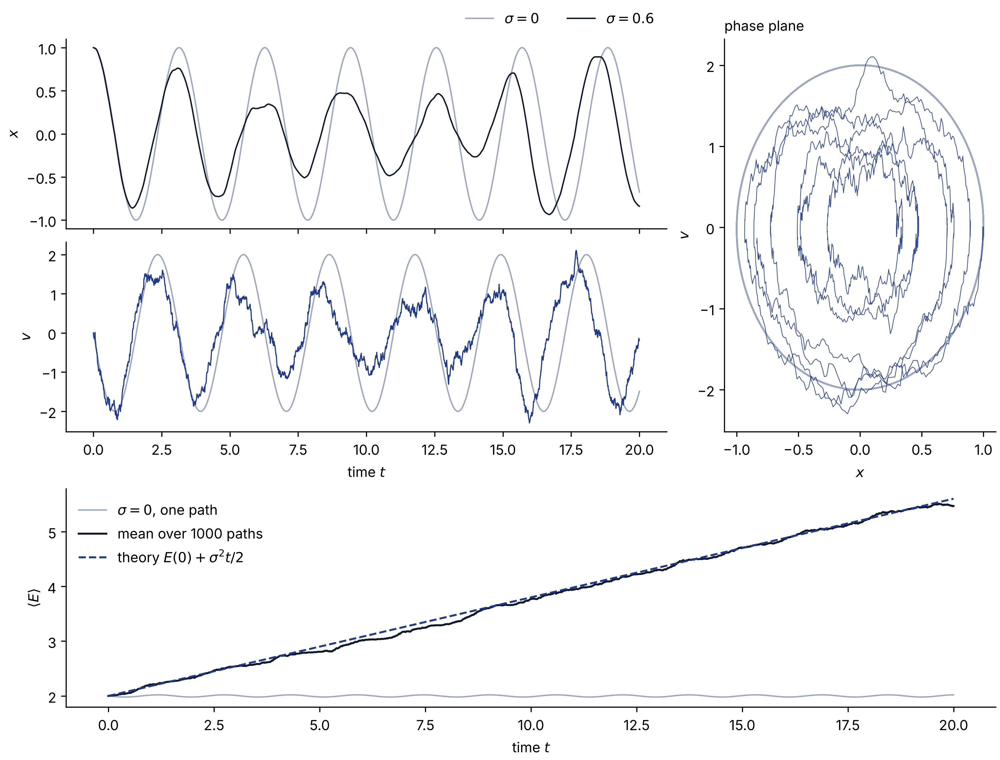

---
date:
  created: 2026-11-05
categories:
  - Numerical methods
  - Stochastic dynamics
slug: euler-maruyama-noisy-harmonic-oscillator
description: How to add noise to an oscillator with the Euler–Maruyama scheme, why the noise term scales with the square root of the time step, and a check against an exact result for the mean energy.
cover: img/euler-maruyama-cover.png
---

# Euler–Maruyama for a noisy harmonic oscillator

Adding noise to an ordinary differential equation costs one extra term in the code and one square root in the maths. This post walks through the Euler–Maruyama scheme on the simplest oscillator there is, shows what the noise does to it, and checks the simulation against an exact prediction.

<!-- more -->

## The model

Take a harmonic oscillator with angular frequency $\omega$ and push it with a random force:

$$
\begin{aligned}
dx &= v\,dt,\\
dv &= -\omega^2 x\,dt + \sigma\,dW.
\end{aligned}
$$

Here $W(t)$ is a Wiener process and $\sigma$ sets the strength of the noise. Only the velocity equation has a noise term. The noise acts as a force, so it kicks the velocity, and the position feels it only through $v$.

## From the Wiener increment to a number

Over one time step $\Delta t$, the deterministic terms are multiplied by $\Delta t$, exactly as in the ordinary Euler method. The noise term needs the increment of the Wiener process over the same step, and that increment is itself a Gaussian random number:

$$
\Delta W_n = W(t_n + \Delta t) - W(t_n) \sim \mathcal{N}(0,\,\Delta t).
$$

In code we draw a standard normal number and scale it:

$$
\Delta W_n = \sqrt{\Delta t}\;\xi_n, \qquad \xi_n \sim \mathcal{N}(0,1).
$$

The square root is the whole point. Split an interval of length $T$ into $N = T/\Delta t$ steps. The increments are independent, so their variances add, and the total must be $T$ however finely we cut the interval: $N\,\Delta t = T$. Each step therefore contributes a standard deviation of $\sqrt{\Delta t}$. Multiply the noise by $\Delta t$ instead and the total variance becomes $N\,\Delta t^2 = T\,\Delta t$, which vanishes as the step shrinks. The noise would simply disappear from the converged solution.

## The scheme

Putting the pieces together gives one update per step:

$$
\begin{aligned}
v_{n+1} &= v_n - \omega^2 x_n\,\Delta t + \sigma\sqrt{\Delta t}\;\xi_n,\\
x_{n+1} &= x_n + v_{n+1}\,\Delta t.
\end{aligned}
$$

The velocity is updated first, and the new velocity $v_{n+1}$ moves the position. This ordering is the semi-implicit, or symplectic, Euler method, and it matters even without noise. Plain explicit Euler uses $v_n$ in the position update, and a two-line calculation shows that it multiplies $v^2 + \omega^2 x^2$ by exactly $1 + \omega^2 \Delta t^2$ at every step, so the deterministic oscillation grows without bound. The semi-implicit version keeps the deterministic orbit closed, which means any growth we see below comes from the noise and not from the integrator.

In Python, with all sample paths advanced together:

```python
import numpy as np


def euler_maruyama_sho(x0, v0, omega, sigma, dt, n_steps, n_paths, rng):
    x = np.empty((n_steps + 1, n_paths))
    v = np.empty((n_steps + 1, n_paths))
    x[0], v[0] = x0, v0
    for n in range(n_steps):
        xi = rng.standard_normal(n_paths)  # one N(0, 1) draw per path
        v[n + 1] = v[n] - omega**2 * x[n] * dt + sigma * np.sqrt(dt) * xi
        x[n + 1] = x[n] + v[n + 1] * dt  # semi-implicit: use the new velocity
    return x, v


rng = np.random.default_rng(5)
x, v = euler_maruyama_sho(
    x0=1.0,
    v0=0.0,
    omega=2.0,
    sigma=0.6,
    dt=0.01,
    n_steps=2000,
    n_paths=1000,
    rng=rng,
)
```

## What the noise does

<figure markdown="span">
  { loading=lazy }
  <figcaption>One sample path without noise, in grey, and one with σ = 0.6, in black and navy, both started from x = 1, v = 0 with ω = 2 and Δt = 0.01. Top left: position. Middle left: velocity. Right: the same paths in the phase plane. Bottom: the energy averaged over 1000 paths, against the Itô prediction.</figcaption>
</figure>

Two things stand out in the top panels.

The velocity is rough and the position is smooth. With $\sigma = 0.6$ and $\Delta t = 0.01$, each kick moves the velocity by about $\sigma\sqrt{\Delta t} = 0.06$, but it moves the position by only $0.06\,\Delta t = 0.0006$ in the same step. Integration smooths, so $x$ inherits the noise as a slow drift of amplitude and phase from one cycle to the next instead of as jitter.

The noisy orbit leaves the deterministic ellipse. In this particular run it drifts inward, and the amplitude of $x$ shrinks. That is a property of this one path, not of the oscillator, and the next section shows that on average the noise does the opposite.

## A check against theory

The mechanical energy is $E = \tfrac12 v^2 + \tfrac12\omega^2 x^2$. Itô's lemma, the chain rule of stochastic calculus, keeps one second-order term because $(dW)^2 = dt$:

$$
dE = v\,dv + \tfrac12\,(dv)^2 + \omega^2 x\,dx = \sigma v\,dW + \tfrac12\sigma^2\,dt.
$$

The $\omega^2 x v\,dt$ terms from the two halves cancel, which is the deterministic energy conservation. The remaining $\sigma v\,dW$ term has zero mean, so

$$
\langle E(t) \rangle = E(0) + \tfrac12\sigma^2 t.
$$

The noise pumps energy in at a constant rate $\sigma^2/2$, and with no friction nothing takes it out. The bottom panel shows the mean over 1000 paths following this line. At $t = 20$ the simulation gives $5.47$ against a prediction of $5.60$, a gap smaller than the sampling error of about $0.17$ for 1000 paths. With 20,000 paths the mean comes out at $5.59$.

## Where to go next

Add friction, $dv = (-\gamma v - \omega^2 x)\,dt + \sigma\,dW$, and the energy stops growing. Noise pumps energy in, friction takes it out, and the mean energy settles at $\sigma^2/(2\gamma)$. That balance between fluctuation and dissipation is the subject of a future post.

The full script, which also draws the figure, is [`scripts/euler_maruyama_sho.py`](https://github.com/SaeedTaghavi/SaeedTaghavi.github.io/blob/main/scripts/euler_maruyama_sho.py) in this site's repository. A longer treatment, with the Ornstein–Uhlenbeck process and a noisy FitzHugh–Nagumo neuron, is in the [SDE chapter](https://computational-neuroscience.ir/ch-num-07-sde/) of my Persian textbook.
