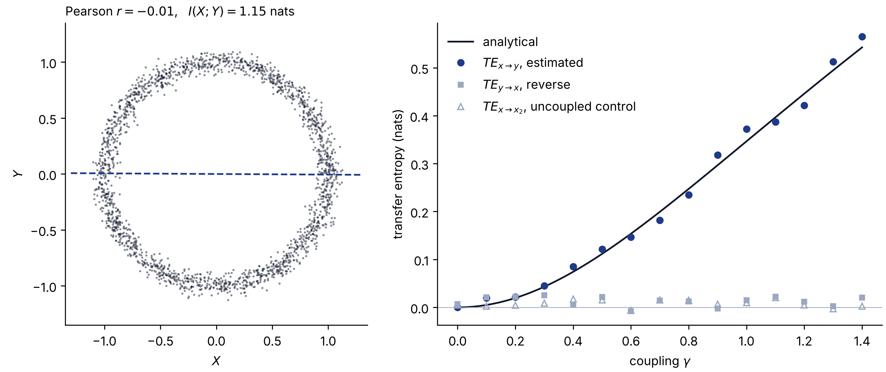

---
date:
  created: 2026-11-05 18:00:00
categories:
  - Tools
  - Information theory
slug: infomeasure-information-theory-in-python
description: A pointer to infomeasure, an open-source Python library with ready-made estimators for entropy, mutual information and transfer entropy, and to a notebook that checks it against analytical results.
cover: img/infomeasure-cover.png
---

# Mutual information and transfer entropy in Python with infomeasure

Struggling to compute measures from information theory in Python? You do not have to write the estimators from scratch. For one of our weekly group meetings I presented infomeasure, an open-source library that does the hard part. This post is a short pointer to it and to the notebook I prepared for that meeting.

<!-- more -->

## Beyond correlation

When we analyse complex time series, correlation is often not enough. It only sees linear relationships, and it has no sense of direction. Two questions keep coming back: are these signals related in any way at all, and does the past of one help predict the other? Mutual information answers the first. Transfer entropy answers the second. Both are easy to write down, but estimating them well from a finite sample of continuous data is hard, and that is where a tested library saves a lot of time.

## The library

[infomeasure](https://github.com/cbueth/infomeasure) puts many estimators behind one interface. For continuous data it offers kernel estimators, the Kozachenko–Leonenko and KSG nearest-neighbour family, and Rényi and Tsallis variants. For discrete data it offers the plug-in estimator and a long list of bias corrections, among them Miller–Madow, NSB and Chao–Shen. Ordinal estimators work on the rank-order patterns of a time series. The same functions compute entropy, mutual information, transfer entropy and their conditional versions, and you switch estimators by changing one argument.

```bash
pip install infomeasure
```

Here a source `x` drives a target `y` with a delay of one step:

```python
import numpy as np
import infomeasure as im

rng = np.random.default_rng(0)
x = rng.normal(size=5000)
y = np.zeros_like(x)
for t in range(1, len(x)):
    y[t] = 0.5 * y[t - 1] + x[t - 1] + rng.normal()

im.mutual_information(x, y, approach="renyi", alpha=1.0)  # same time step
im.transfer_entropy(x, y, approach="renyi", alpha=1.0)  # source x, target y
im.transfer_entropy(y, x, approach="renyi", alpha=1.0)  # reverse direction
```

The mutual information at the same time step is about 0.02 nats, close to nothing, because `y` depends on the past of `x` and not on its present. The transfer entropy from `x` to `y` is 0.38 nats, against an analytical value of $\tfrac{1}{2}\log 2 \approx 0.35$. The reverse direction stays near zero at 0.01. Three lines, and the direction of the coupling is clear.

The Rényi estimator with `alpha=1.0` reduces to the usual Shannon quantities, and it is the one I used in the notebook. Writing `approach="ksg"` or `approach="kernel"` swaps in another estimator with the same call.

## What is in the notebook

The [notebook](https://github.com/SaeedTaghavi/infomeasure_tutorial/blob/main/infomeasure.ipynb) combines code and examples from the official documentation with numerical experiments of my own. In each experiment the answer is known in closed form, so every estimate can be checked:

- Pearson correlation against mutual information on a noisy circle.
- The entropy of a Gaussian, for 50, 100 and 500 samples.
- The mutual information of two correlated Gaussians, against $-\tfrac{1}{2}\log\left(1-\rho^2\right)$.
- Transfer entropy in the process above for a range of couplings $\gamma$, against $\tfrac{1}{2}\log\left(1+\gamma^2\sigma_x^2/\sigma_y^2\right)$, with an uncoupled signal as a control.
- How the run time of transfer entropy grows with the length of the series, from 10,000 to 100,000 samples.

<figure markdown="span">
  { loading=lazy }
  <figcaption>Two of the checks, redrawn. Left: on a noisy circle of 2000 points, Pearson's r is close to zero while the mutual information is 1.15 nats. Right: with 5000 samples per point, the transfer entropy from x to y grows with the coupling γ and follows the analytical curve. The reverse direction and an uncoupled control stay near zero.</figcaption>
</figure>

The script that draws this figure is [`scripts/infomeasure_checks.py`](https://github.com/SaeedTaghavi/SaeedTaghavi.github.io/blob/main/scripts/infomeasure_checks.py) in this site's repository. The library's documentation is at [infomeasure.readthedocs.io](https://infomeasure.readthedocs.io/).

## Let's discuss

Do you use measures from information theory in your own projects? I am keen to hear how you use them, and which questions made you choose them over standard statistical tools. Write to me by [email](mailto:saeed.taghavi.v@gmail.com) or on [LinkedIn](https://www.linkedin.com/in/saeed-taghavi-a16488130/).
