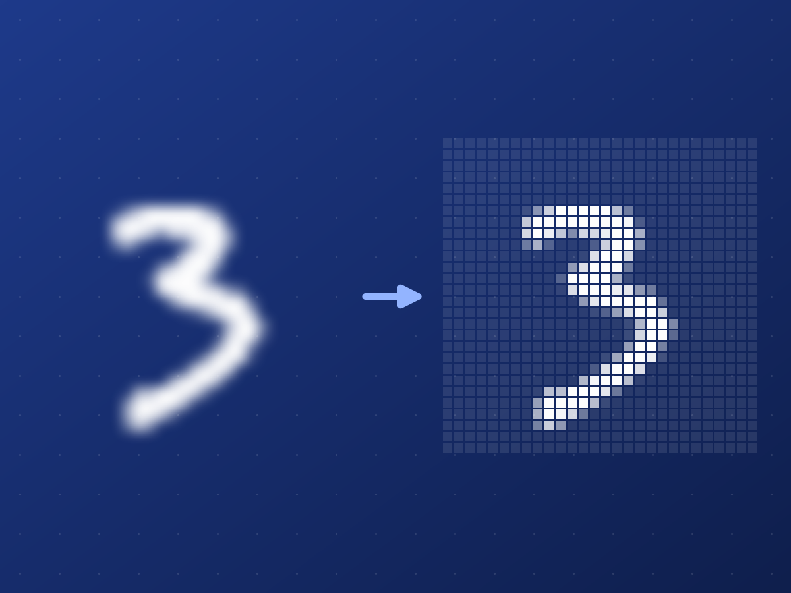

---
date:
  created: 2026-11-05 20:45:00
categories:
  - Deep learning
  - Engineering
slug: lenet-web-app
description: A small web app that reads an uploaded handwritten digit with LeNet-5. Two Docker containers, one FastAPI endpoint, and a page that shows what the network actually sees.
cover: img/lenet-web-app-cover.png
tags:
  - Machine learning
  - PyTorch
  - Docker
  - Python
---

# A web app that reads handwritten digits with LeNet-5

Training a network is half of the story. The other half is getting it out of the training script and in front of someone who can drop an image on a page and see what it thinks. The first chapter of my [deep learning course](https://github.com/SaeedTaghavi/deep-learning-course/tree/main/01-lenet-mnist) does exactly that with LeNet-5 and MNIST, and this post walks through the small web app at its centre.

<!-- more -->

## Two containers and a shared volume

The app is two Docker containers that share one volume. The first trains the model, writes the weights and exits. The second loads the weights and serves the page.

```
trainer  --- writes lenet_mnist.pth --->  [ model_data volume ]  --- reads --->  webapp
```

The trainer downloads MNIST and trains LeNet-5 for five epochs with Adam. LeNet-5 is the convolutional network LeCun and colleagues published in 1998 for reading handwritten digits on bank cheques; this version uses ReLU and max-pooling. The web app is a FastAPI server. At startup it waits until the weights file appears, loads it, and then answers on two routes: `/` returns the page and `/predict` takes an image.

Splitting the work this way keeps the serving image free of any training code, and it is the same shape a production deployment would have: a job that produces an artefact, and a service that consumes it.

## The prediction endpoint

The heart of `/predict`, slightly trimmed:

```python
image = Image.open(io.BytesIO(contents)).convert("L")
image = ImageOps.invert(image)          # ink on paper -> white on black
tensor = transform(image).unsqueeze(0)  # grayscale, 28 x 28, tensor
with torch.no_grad():
    probs = torch.exp(model(tensor))[0]  # model ends in log-softmax
prediction = probs.argmax().item()
```

The endpoint returns JSON with the predicted digit, its confidence, the probabilities of all ten digits and the 28 × 28 image the network received, encoded as a PNG. The page is a thin client around it: choose a file, drop it on the page or paste it from the clipboard, and it draws the answer as ten bars.

## What the network sees

That last field turned out to be the most useful part of the page. MNIST digits are white on black, 28 × 28 pixels, and each one is scaled into a 20 × 20 box and centred by its centre of mass. A photo of a digit on paper looks nothing like that. The app inverts every upload and squashes it to 28 × 28, so a small digit in a large photo shrinks to a few grey pixels, and a white digit on black is inverted into the wrong polarity. In both cases the prediction is wrong for a reason you can see immediately, because the page shows the input next to the answer.

<figure markdown="span">
  { loading=lazy width="420" }
  <figcaption>MNIST test image 30, smoothed for display on the left, and the 28 × 28 pixels that LeNet-5 actually receives on the right.</figcaption>
</figure>

## Shortcuts left in on purpose

This CPU version keeps a few rough edges, because each one is a lesson. The model is retrained on every start. The `LeNet` class is copied into both containers, so the two copies can drift apart. The web app reads the weights file as soon as it appears, even if the trainer is still writing it. Uploads are never cropped or centred.

The GPU version in the same chapter fixes each of these. Both services import one shared model file, training runs only when no saved model exists, the web app starts only after the trainer has finished successfully, and the app detects the background so either polarity works.

## Run it

You need Docker:

```bash
git clone https://github.com/SaeedTaghavi/deep-learning-course.git
cd deep-learning-course/01-lenet-mnist/mnist-app-cpu
docker compose up --build
```

The trainer prints its loss for each epoch and exits, then the web app starts serving the page. The [chapter's README](https://github.com/SaeedTaghavi/deep-learning-course/tree/main/01-lenet-mnist) explains the model, the dataset, and how to export MNIST digits as images to upload.
