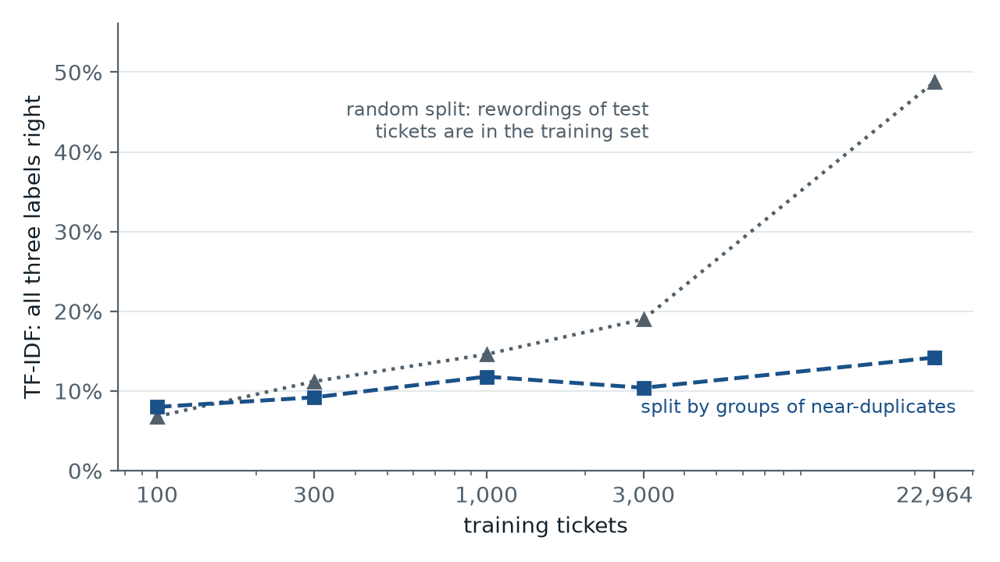
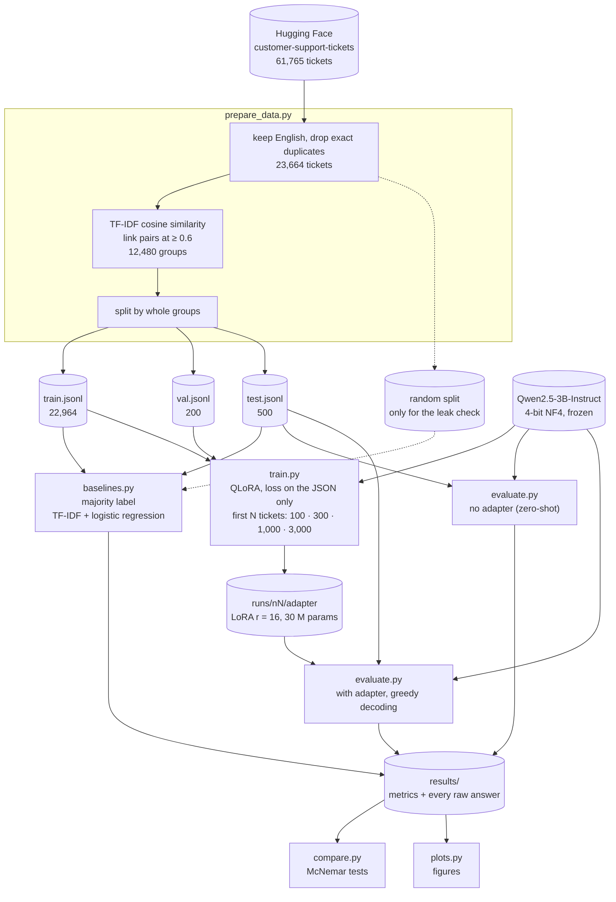
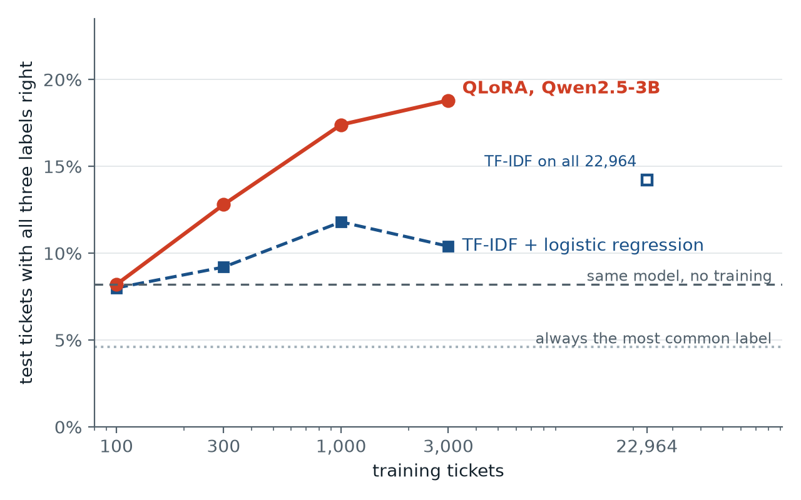
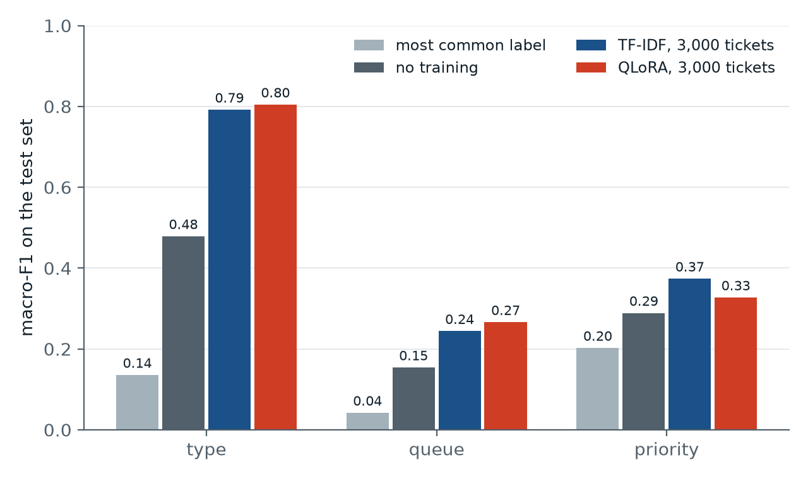
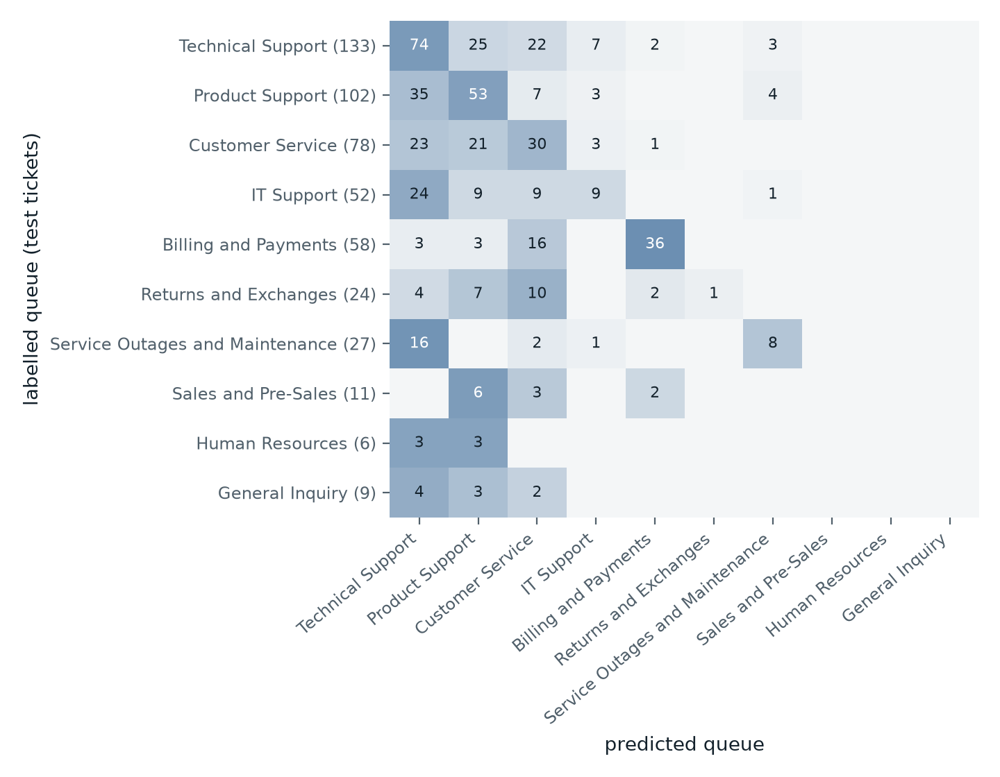
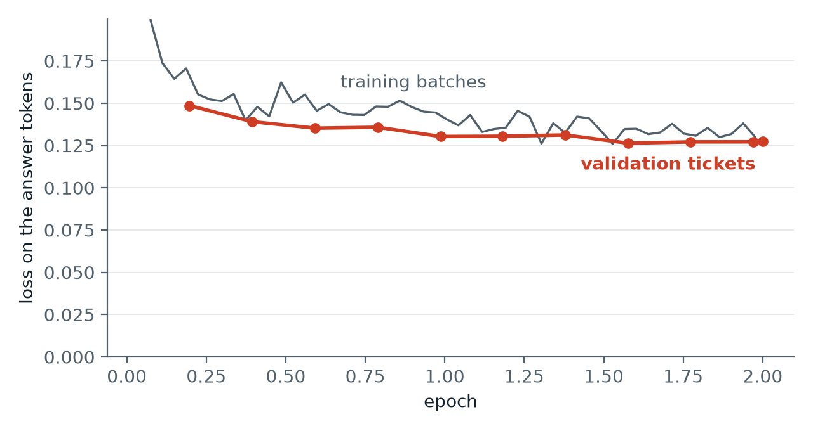

# Fine-tuning a small language model: routing support tickets with QLoRA

I wanted to fine-tune a language model myself, end to end, on hardware I own, and measure whether it helped. This post is that experiment. A 3-billion-parameter model learns to read a customer support ticket and answer with one line of JSON: what kind of ticket it is, which team should handle it, and how urgent it is. The code is in [ai-projects/03-ticket-routing-qlora](https://github.com/SaeedTaghavi/ai-projects/tree/main/03-ticket-routing-qlora) and runs on one RTX 4070 with 12 GB.

The most useful thing I learned had nothing to do with the language model. The dataset leaks, and the leak doubles the score of a simple classifier before any fine-tuning starts.

<!-- more -->

## What fine-tuning is

A language model is trained in stages. Pre-training on a large amount of text teaches it to predict the next token, and with that, grammar, facts and some reasoning. A second stage on examples of instructions and good answers turns it into an assistant that follows requests; Qwen2.5-3B-*Instruct* has been through both. Fine-tuning is one more stage that you run yourself. You take the trained model and continue training it on a small set of examples of your own, each an input and the exact output you want, with the same next-token loss as before. Gradient descent then nudges the weights until the model produces those outputs. This is different from prompting, where the instructions and a few examples go into the input every time and no weight changes, and from retrieval (RAG), where relevant documents are looked up and pasted into the prompt at query time.

Full fine-tuning updates every weight of the model, which for billions of weights needs far more GPU memory than one card has. Parameter-efficient methods such as LoRA freeze the original weights and train a small number of added ones instead, which is what this post does. Fine-tuning is good at teaching a model a format, a style, or a narrow decision that it should make the same way every time. It is a poor way to teach new facts: those are better supplied through the prompt or retrieval.

## Why this task

A first fine-tuning project should have an answer that can be checked. Creative writing can't be scored; a label can. Routing a ticket is a narrow decision with a fixed output format, exactly the kind of job described above.

The answer the model must give:

```json
{"type": "Incident", "queue": "Technical Support", "priority": "high"}
```

Each field is scored separately against the label, and a ticket counts as fully right only if all three match.

## The data

[Tobi-Bueck/customer-support-tickets](https://huggingface.co/datasets/Tobi-Bueck/customer-support-tickets) on Hugging Face holds 61,765 tickets with a subject, a body, and the three labels. Its licence is CC BY-NC 4.0, so the repository downloads it rather than storing a copy. The tickets are synthetic, written by a language model, about half in English and half in German. I kept the English ones and dropped exact duplicates, which left 23,664. In English the labels take few values:

| Field | Values |
|---|---|
| `type` | Incident, Request, Problem, Change |
| `queue` | ten teams, from Technical Support (28 %) down to General Inquiry (1.4 %) |
| `priority` | high, medium, low |

The labels are noisy. The first training ticket I opened reported a security breach of medical data and was filed under Sales and Pre-Sales. That matters for everything below: no model can get close to 100 %, and only a comparison with other models says whether a score is good.

## The leak

My first split was the usual one: 500 random tickets for testing, 200 for validation, the rest for training. Then I trained the cheapest classifier I know, TF-IDF word counts and a logistic regression per field. On all 23,000 training tickets it got all three labels right for 49 % of the test tickets. On 3,000 it got 19 %. A jump like that from more of the same data is suspicious, and so was the priority accuracy, which rose far above what the text seemed to support.

The dataset holds several rewordings of most tickets. They are not exact duplicates, so dropping duplicate bodies doesn't remove them; they differ in a few words:

> I am reporting a critical issue impacting the investment data analytics. Several key applications, such as Evernote and Figma, are experiencing severe performance problems…
>
> I am preparing a report on a critical issue affecting our investment data analytics. Several key applications, such as Evernote and Figma, are experiencing severe performance problems…

For each test ticket I looked up the most similar training ticket, by the cosine similarity of their TF-IDF vectors. With the random split, 56 % of the test tickets had a training ticket at similarity 0.7 or more, and in 99 % of those cases the two carried the same three labels. With enough training data, the classifier wasn't learning to route tickets. It was finding the copy and reading off its labels.

The fix is to split by group instead of by ticket. `prepare_data.py` links every pair of tickets with similarity of at least 0.6, takes the connected groups, and draws test and validation tickets as whole groups. A lower threshold chains unrelated tickets into one group of 6,000; 0.6 gives 12,480 groups, the largest with 1,030 tickets. After the group split, no test ticket has a training ticket at similarity 0.6 or more, against 70 % before.

<figure markdown="span">
  { loading=lazy }
  <figcaption>The same classifier on two splits of the same tickets. The random split rewards memorising rewordings, and more data means more of them.</figcaption>
</figure>

With the leak closed, TF-IDF trained on all 23,000 tickets gets all three labels right for 14 % of the test tickets. Every number from here on uses the group split.

## Three baselines

A fine-tuned model is only interesting next to what it replaces. I measured three things before training anything.

**Always the most common label** (Incident, Technical Support, medium) gets all three right for 4.6 % of the test tickets. This is the floor.

**TF-IDF and logistic regression** trains in seconds on a CPU. On 3,000 tickets it reaches 10 %, on all 23,000 14 %. It does well on `type` (81 % on all data), less well on `queue` (38 %), and on `priority` it barely beats guessing "medium" (46 % against 44 %). Priority seems to be mostly noise with respect to the text.

**Qwen2.5-3B-Instruct without training**, given the label lists in its prompt, gets 8.2 %. Every answer was valid JSON, but 13 % used a label that wasn't in the list. The model invented 55 queues, mostly variants of marketing ("Marketing Support", "Marketing and Sales"), plus "Financial Services" and "Information Request". It never answered `low` priority: 393 tickets were "high", 107 "medium". An instruction-tuned model asked about urgency seems to lean towards treating everything as urgent.

## QLoRA in brief

Fine-tuning all 3 billion weights of the model needs far more than 12 GB: the weights, their gradients and the optimiser state would add up to around 50 GB. QLoRA gets around this in two steps.

1. **Quantise the frozen model to 4 bits.** The weights are stored in NF4, a 4-bit format whose 16 levels are spaced for normally distributed weights, and they are not trained. The 3B model then takes 1.9 GB instead of 5.8.
2. **Train a small low-rank correction.** Next to each linear layer, LoRA adds two thin matrices $A$ ($r \times d$) and $B$ ($d \times r$) with rank $r = 16$. The layer computes $Wx + BAx$, where $W$ is frozen and only $A$ and $B$ learn. Over every linear layer of the model, that is 30 million trainable parameters, 0.96 % of the total.

The loss is computed only on the answer. The prompt (instructions, label lists, ticket) is masked out, so the model isn't trained to reproduce tickets, only to produce the JSON that follows them. In TRL this happens automatically when the data is given as separate prompt and completion:

```python
{"prompt": [{"role": "system", "content": SYSTEM_PROMPT},
            {"role": "user", "content": ticket_text}],
 "completion": [{"role": "assistant", "content": '{"type": "Incident", ...}'}]}
```

The model loading and adapter, from `train.py`:

```python
quant = BitsAndBytesConfig(load_in_4bit=True, bnb_4bit_quant_type="nf4",
                           bnb_4bit_use_double_quant=True,
                           bnb_4bit_compute_dtype=torch.bfloat16)
model = AutoModelForCausalLM.from_pretrained(BASE_MODEL, quantization_config=quant)
model = prepare_model_for_kbit_training(model, use_gradient_checkpointing=True)
model = get_peft_model(model, LoraConfig(r=16, lora_alpha=32, lora_dropout=0.05,
                                         target_modules="all-linear", task_type="CAUSAL_LM"))
```

Every run trains for two epochs with a learning rate of $2 \times 10^{-4}$ on a cosine schedule and an effective batch of 16 tickets. Training took 4 minutes on 100 tickets and 26 minutes on 3,000, and PyTorch never allocated more than 5.0 GB of GPU memory, so an 8 GB card should be enough. Scoring the 500 test tickets takes one to two minutes.

## The whole pipeline

Each box below is one script in the project folder. The dotted path is the random split, kept only to measure the leak.



One 4-bit base model serves both training and evaluation; only the small adapter changes with the size of the training set. Every model, trained or not, is scored on the same 500 test tickets.

## Results

All numbers are on the same 500 test tickets, which share no near-duplicates with the training tickets.

| Model | Training tickets | Valid labels | `type` | `queue` | `priority` | All three |
|---|---:|---:|---:|---:|---:|---:|
| Always the most common label | | | 37.2 % | 26.6 % | 43.6 % | 4.6 % |
| Qwen2.5-3B, no training | 0 | 86.8 % | 55.2 % | 26.0 % | 41.0 % | 8.2 % |
| TF-IDF + logistic regression | 3,000 | | 79.2 % | 36.8 % | 40.0 % | 10.4 % |
| TF-IDF + logistic regression | 22,964 | | 81.4 % | 38.0 % | 45.6 % | 14.2 % |
| Qwen2.5-3B + QLoRA | 100 | 97.0 % | 65.2 % | 31.2 % | 35.6 % | 8.2 % |
| Qwen2.5-3B + QLoRA | 300 | 100 % | 75.0 % | 35.0 % | 41.6 % | 12.8 % |
| Qwen2.5-3B + QLoRA | 1,000 | 100 % | 80.8 % | 39.6 % | 43.4 % | 17.4 % |
| Qwen2.5-3B + QLoRA | 3,000 | 100 % | 81.6 % | 42.2 % | 44.0 % | **18.8 %** |

"Valid labels" is the share of answers that are valid JSON with three values from the lists. Every model produced valid JSON every time; the untrained one failed by inventing labels.

<figure markdown="span">
  { loading=lazy }
  <figcaption>On paper, the fine-tuned model passes TF-IDF trained on the whole training set somewhere between 300 and 1,000 tickets. The test below says the gap is clear only at 3,000.</figcaption>
</figure>

**The format comes first and fast.** A hundred examples were enough to stop the model inventing queues (97 % valid labels), and three hundred stopped it entirely. Accuracy took longer: at 100 tickets the fine-tuned model got all three right no more often than the untrained one.

**Then it beats the classical baseline, by a little.** With 3,000 tickets, the fine-tuned model gets all three labels right for 18.8 % of test tickets, against 10.4 % for TF-IDF on the same 3,000 and 14.2 % for TF-IDF on all 22,964. On 500 tickets these differences need a test, not just a glance. A McNemar test counts the tickets where only one of two models is right. Against TF-IDF on 3,000 tickets the split is 73 to 31 ($p < 0.001$). Against TF-IDF on all the data it is 72 to 49 ($p = 0.045$), a real but modest difference. Between fine-tuning on 1,000 and on 3,000 tickets it is 29 to 22 ($p = 0.40$), so tripling the data and the training time bought nothing I can distinguish from noise.

<figure markdown="span">
  { loading=lazy }
  <figcaption>Macro-F1 averages the F1 score of each class, so a small queue counts as much as a large one.</figcaption>
</figure>

**Per field, the gain is in `queue`.** On `type` the fine-tuned model and TF-IDF are level. On `queue` the fine-tuned model is ahead. On `priority`, TF-IDF has the higher macro-F1, 0.37 against 0.33. The reason is in the answers: of 500 test tickets, 104 are labelled `low`, and the fine-tuned model answered `low` twice. With labels this noisy, the safest way to lower the loss is to learn the class frequencies, and that is what it did. The logistic regression was trained with class weights that make rare classes count more, so it guesses `low` more often and gets more of them right.

<figure markdown="span">
  { loading=lazy }
  <figcaption>Rows are the labelled queue, columns the queue the fine-tuned model chose. Darker cells hold a larger share of the row.</figcaption>
</figure>

The confusion matrix shows the same habit. Billing and Payments is the one queue with words of its own, and the model gets 36 of its 58 tickets. Technical Support, Product Support, Customer Service and IT Support blur into each other, as they probably do in the real help desks that the synthetic tickets imitate. The three smallest queues, Sales and Pre-Sales, Human Resources and General Inquiry, never appear in the model's answers at all.

<figure markdown="span">
  { loading=lazy }
  <figcaption>The run on 3,000 tickets. The loss covers only the answer tokens.</figcaption>
</figure>

The loss curves show no overfitting. The validation loss drops during the first epoch and stays flat during the second. It is low in absolute terms because most tokens of the answer, such as `{"type": "` and the closing brace, are certain after the first few steps; all of the remaining loss sits in the handful of tokens that carry the three labels.

## What I take from it

- **Look for leaks before training anything.** The biggest effect in this whole experiment was the split. A random split more than tripled the score of TF-IDF, and I would have had no idea how much of the fine-tuned model's score was memory. Checking for near-duplicates with TF-IDF took a minute.
- **Always run a cheap baseline.** Without the TF-IDF line, the fine-tuned model's 18.8 % would have no meaning. With it, the gain is real but small, and it costs a GPU and half an hour against a few seconds on a CPU.
- **Fine-tuning fixes the format almost for free.** If the goal is that a small model always answers with valid labels in a fixed schema, a few hundred examples are enough. That is the clearest win here.
- **The data decides the ceiling.** No method gets far above 20 % on all three fields, because the labels themselves are inconsistent. More epochs, more tickets or a bigger model will not fix that; cleaner labels would.
- **Test differences on small test sets.** 17.4 % against 18.8 % looks like progress, and isn't distinguishable from noise on 500 tickets.

## Run it yourself

The [project folder](https://github.com/SaeedTaghavi/ai-projects/tree/main/03-ticket-routing-qlora) has every script, the metrics, every raw answer of every model, and the figures. On an NVIDIA GPU with 8 GB or more:

```bash
git clone https://github.com/SaeedTaghavi/ai-projects.git
cd ai-projects/03-ticket-routing-qlora
python -m venv .venv && source .venv/bin/activate     # Windows: .venv\Scripts\activate
pip install torch --index-url https://download.pytorch.org/whl/cu128
pip install -r requirements.txt

python prepare_data.py                     # download, filter, group split
python baselines.py                        # majority and TF-IDF
python evaluate.py --name zero-shot        # the model before training
python train.py --n-train 1000             # about 10 minutes on an RTX 4070
python evaluate.py --name n1000 --adapter runs/n1000/adapter
python plots.py
```

The first run downloads the model, about 6 GB. Everything is seeded and decoding is greedy, so the numbers should come out the same, up to small differences between GPUs and library versions.
